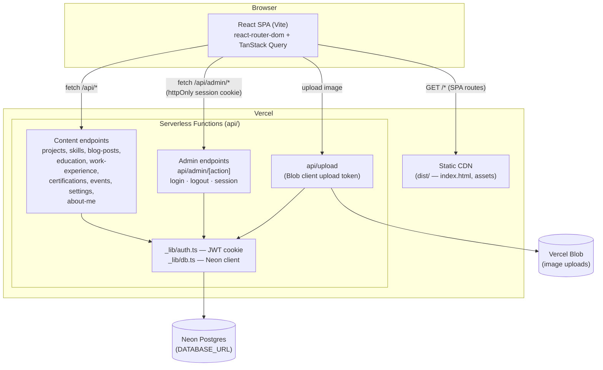

# 🌟 My Portfolio Website

Welcome to my portfolio website! This project showcases my work, skills, and experiences in a beautifully crafted and responsive design.


## 🚀 Live Demo

🔗 **[Visit My Portfolio](https://portfolio-website-vaibhavee.vercel.app)**

## 📌 About the Project

This portfolio website serves as a personal space to highlight my achievements, projects, and professional journey. Built with modern technologies, it ensures a smooth and visually appealing user experience.

## 🛠️ Tech Stack

**Frontend**
- ⚡ **Vite** - Fast build tool for modern web development.
- 📜 **TypeScript** - Ensuring type safety and better development experience.
- ⚛️ **React** - A powerful library for building user interfaces.
- 🎨 **shadcn-ui** / **Tailwind CSS** - UI components and utility-first styling.
- 🌌 **Three.js** (via `@react-three/fiber`) - The scroll-driven space background scene.

**Backend / admin panel**
- ▲ **Vercel Serverless Functions** (`api/`) - REST endpoints for all content and admin auth.
- 🐘 **Postgres on Neon** (`@neondatabase/serverless`) - Persistent storage for every content section.
- 🔐 Session cookie auth (JWT, httpOnly) for the `/admin` panel - see `BACKEND_SETUP.md`.

## ✨ Features

- 🎭 **Modern UI/UX** - A clean and elegant design with a live 3D background.
- 🎨 **Multiple Colour Themes** - Visitors can switch themes from the header; the admin sets the site default.
- 📜 **Responsive Design** - Works perfectly on all screen sizes.
- 📄 **Project Showcase** - Displaying my best projects with detailed descriptions.
- 🛠️ **Admin Panel** (`/admin`) - Edit projects, skills, certifications, education, work experience, blog posts, events and landing-page content, backed by Postgres.
- 📧 **Contact Section** - Easy-to-use contact form for networking.

## 🏛️ Architecture



**Request flow**

1. **Frontend** — a Vite/React SPA (`src/`) is built to static assets and served from Vercel's CDN. `vercel.json` rewrites every non-`/api` path back to `index.html` so client-side routing works on refresh/deep links.
2. **Data fetching** — page components call hooks in `src/hooks/` (one per content type), which hit the matching REST endpoint under `api/*.ts` via TanStack Query.
3. **API layer** — each `api/*.ts` file is an independent Vercel serverless function (Node runtime via `@vercel/node`). Public GET endpoints read content tables; the same files guard their write methods (`PUT`/`POST`/`DELETE`) behind `requireAuth`.
4. **Auth** — `api/admin/[action].ts` handles `login`/`logout`/`session`. On login it verifies credentials against the `admin` table (bcrypt) and sets an httpOnly, `SameSite=strict` JWT cookie (`api/_lib/auth.ts`). Every admin write handler calls `requireAuth`, which is the real security boundary — the client-side `AuthContext`/`ProtectedRoute` only control what the UI shows.
5. **Database** — all functions share one Neon Postgres client (`api/_lib/db.ts`, via `@neondatabase/serverless`), reading `DATABASE_URL`/`POSTGRES_URL`. Schema lives in `db/schema.sql`; `db/seed.mjs` creates tables and seeds them from `src/data/mockData.ts`.
6. **Image uploads** — the admin panel requests a client upload token from `api/upload.ts`, which authenticates the admin then calls `@vercel/blob/client`'s `handleUpload`; the browser uploads the file directly to Vercel Blob and stores the returned URL on the relevant record.

## 📁 Project Structure

```
api/                  Vercel serverless functions (REST API + admin auth)
  _lib/                 Shared auth (JWT/cookie) and database client
  admin/                 Login / logout / session-check endpoints
  *.ts                  One file per content type (projects, skills, ...)
db/                    Postgres schema, seed script, migration scripts
public/                Static assets (images, resume, favicon)
src/
  components/
    sections/            Page sections (Hero, About, Projects, ...)
    layout/               Header, Footer, ThemeSwitcher
    admin/                Admin panel layout & route guard
    three/                The Three.js space background
    ui/                   shadcn-ui primitives
  contexts/              Auth and site-settings React contexts
  hooks/                 Data-fetching hooks, one per content type
  lib/                   Shared helpers (themes, utils)
  pages/                 Route-level pages, including pages/admin/*
```

## 🏗️ How to Run Locally

```sh
# Step 1: Clone the repository
git clone <YOUR_GIT_URL>

# Step 2: Navigate to the project folder
cd <YOUR_PROJECT_NAME>

# Step 3: Install dependencies
npm install

# Step 4: Start the frontend-only dev server (no /api routes)
npm run dev
```

`npm run dev` serves the frontend only — it can't run the `/api` routes
(Vite doesn't execute them as serverless functions). To exercise the admin
panel and backend locally, follow **`BACKEND_SETUP.md`** to connect a Neon
database and run `npx vercel dev` instead.

## 📌 Contributing

If you'd like to contribute, feel free to fork this repository and submit a pull request! 🎉

## 📞 Contact

For any inquiries, collaborations, or feedback, you can reach out to me via:

📧 [Email](vaibhaveesingh89@gmail.com)

🔗 [LinkedIn](https://www.linkedin.com/in/vaibhavee-singh-1b7996252/)

🐦 [Twitter](https://twitter.com/yourhandle)

---

💙 *Thank you for visiting my portfolio! Feel free to explore and connect!* 🚀


